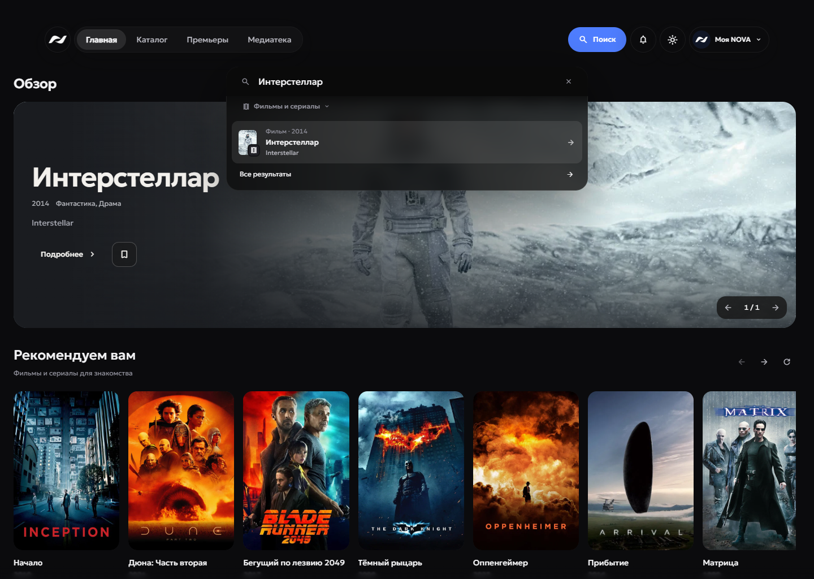
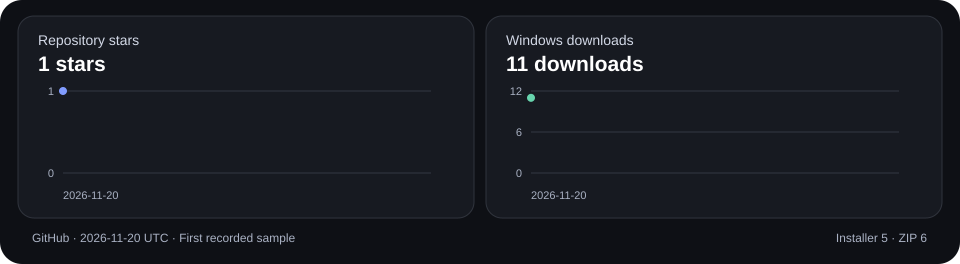

<h1 align="center">
  <picture>
    <source media="(prefers-color-scheme: dark)" srcset="docs/nova-wordmark-dark.png">
    
  </picture>
</h1>

<p align="center">An open-source movie and TV catalog for Windows.</p>

<p align="center">
  <a href="https://github.com/DeLorean-bot/NOVA/releases/latest"></a>
</p>

<p align="center">
  <a href="https://delorean-bot.github.io/NOVA/?lang=en">Website</a> · <a href="#install">Install or run from ZIP</a> · <a href="#screenshots">Screenshots</a> · <a href="#project-activity">Activity</a> · <a href="#contribute">Contribute</a> · <a href="docs/support.md">Support NOVA</a> · <a href="README.ru.md">Русский</a>
</p>

[](docs/screenshots/overview-dark.png)

## Install

Open the [latest Windows x64 release](https://github.com/DeLorean-bot/NOVA/releases/latest) and choose a download under **Assets**.

| Download | How to start |
| --- | --- |
| **Windows installer** · `NOVA-Setup-*.exe` | Run setup and open NOVA from the Start menu. Installed copies download updates in the background and prompt you to restart. |
| **Portable ZIP** · `NOVA-*-win-x64.zip` | Extract the entire archive and open `NOVA.exe`. The portable app links to the latest release when an update is available. |

English and Russian are available under **Settings → Interface language**. By default, NOVA follows the Windows language preference. Artwork and metadata follow their sources.

[Release history and checksums](https://github.com/DeLorean-bot/NOVA/releases) · [Windows build status](https://github.com/DeLorean-bot/NOVA/actions/workflows/ci.yml)

## Screenshots

| Search · dark theme | Title details · light theme |
| --- | --- |
| [](docs/screenshots/search-dark.png) | [](docs/screenshots/details-light.png) |

The screenshots show a sample catalog in a separate profile. Movie artwork belongs to its respective owners.

- **Find a title** by name, cast, or a plot detail you remember. The catalog includes year, genre and country filters.
- **Pick what to watch** with trailers, ratings, recommendations based on your viewing and a premieres calendar.
- **Keep watching** by returning to an open film from its poster preview. Your collection, ratings and viewing history are saved locally.

<details>
<summary>Keyboard shortcuts</summary>

| Shortcut | Action |
| --- | --- |
| <kbd>Ctrl</kbd> + <kbd>L</kbd> | Search |
| <kbd>F</kbd> | Toggle player fullscreen |
| <kbd>F11</kbd> | Toggle app fullscreen |
| <kbd>Esc</kbd> | Close the current panel or exit fullscreen |

</details>

## Project activity

[](docs/activity/README.md)

The chart uses daily GitHub snapshots. Downloads count the Windows installer and portable ZIP. [Daily data](docs/activity/history.json) · [Stargazers](https://github.com/DeLorean-bot/NOVA/stargazers)

## Contribute

NOVA is in active development. Windows is the current platform, and support for more devices is planned. [Report a bug](https://github.com/DeLorean-bot/NOVA/issues/new?template=bug.yml) · [Suggest a feature](https://github.com/DeLorean-bot/NOVA/issues/new?template=feature.yml) · [Support development](docs/support.md)

<details>
<summary>Build from source on Windows</summary>

With Node.js 24 installed, run the following from the repository root.

```powershell
npm ci
npm start
```

Before opening a pull request, run `npm run check`, `npm run build` and `npm test`. Use `npm run dist` to package the installer and ZIP. [Architecture and startup measurements](docs/architecture.md) · [English translations](electron/locales/en.json)

</details>

NOVA is licensed under [GPL-3.0-only](LICENSE). [Third-party notices](THIRD_PARTY_NOTICES.md)
