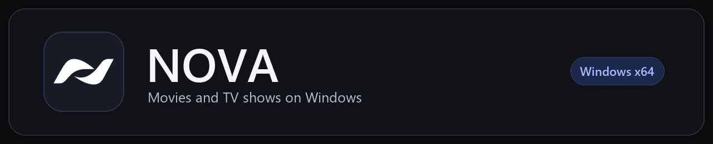

<p align="center"><a href="https://github.com/DeLorean-bot/NOVA/releases/latest"></a></p>

<p align="center">
  <a href="https://github.com/DeLorean-bot/NOVA/releases/latest"></a>
  <a href="https://github.com/DeLorean-bot/NOVA/stargazers"></a>
  <a href="https://github.com/DeLorean-bot/NOVA/actions/workflows/ci.yml"></a>
  <a href="docs/support.md"></a>
</p>

<p align="center">
  <a href="#screenshots">Screenshots</a> · <a href="#activity">Activity</a> · <a href="#install">Install</a> · <a href="#build-from-source">Build</a> · <a href="docs/support.md">Support</a> · <a href="README.ru.md">Русский</a>
</p>

> [!NOTE]
> NOVA is in active development. It’s available for Windows today, and I plan to bring it to more devices. I’d love to hear what you want to see next and where the app falls short.
>
> [Suggest a feature](https://github.com/DeLorean-bot/NOVA/issues/new?title=Feature%20request%3A%20) · [Report a bug](https://github.com/DeLorean-bot/NOVA/issues/new?title=Bug%3A%20) · [Support development](docs/support.md)

[](docs/screenshots/overview-dark.png)

Browse movies and TV shows, open title details and trailers, and save films to your local collection. NOVA includes region and genre filters, ratings you can change, and notifications for followed releases. The interface follows your Windows language preferences by default. You can choose Russian or English in **Settings → Interface language**. Catalog artwork, descriptions, and external players use the languages provided by their sources.

## Screenshots

| Search · Dark theme | Settings · Light theme |
| --- | --- |
| [](docs/screenshots/search-dark.png) | [](docs/screenshots/settings-light.png) |

Screenshots use a separate profile. Movie artwork and provider marks belong to their respective owners.

## Activity

[](docs/activity/README.md)

[Stars](https://github.com/DeLorean-bot/NOVA/stargazers) · [Release assets](https://github.com/DeLorean-bot/NOVA/releases) · [Raw daily samples](docs/activity/history.json) · [Architecture and startup timings](docs/architecture.md)

Downloads count the Windows installer and portable ZIP. The chart records one snapshot per day from the GitHub API.

## Install

| Download | How to launch |
| --- | --- |
| [Windows installer](https://github.com/DeLorean-bot/NOVA/releases/download/v0.8.3/NOVA-Setup-0.8.3.exe) | Run setup and open NOVA from Start. |
| [Portable Windows ZIP](https://github.com/DeLorean-bot/NOVA/releases/download/v0.8.3/NOVA-0.8.3-win-x64.zip) | Extract the entire archive, then open `NOVA.exe`. |

[All releases and checksums](https://github.com/DeLorean-bot/NOVA/releases)

| Shortcut | Action |
| --- | --- |
| Ctrl+L | Open search |
| F | Toggle player fullscreen |
| F11 | Toggle app fullscreen |
| Esc | Close the current panel or exit fullscreen |

## Build from source

NOVA uses Node.js 24 for Windows development and CI.

```powershell
npm ci
npm start
```

Use `npm run check`, `npm run build`, then `npm test` to verify a change. Use `npm run dist` to build the Windows installer and ZIP. English interface text lives in [the translation catalog](electron/locales/en.json).

## Support and license

[Support NOVA](docs/support.md) · [Report an issue](https://github.com/DeLorean-bot/NOVA/issues/new)

NOVA is released under [GPL-3.0-only](LICENSE). You can use, study, modify, and redistribute it under the terms of the license. [Third-party notices](THIRD_PARTY_NOTICES.md)
