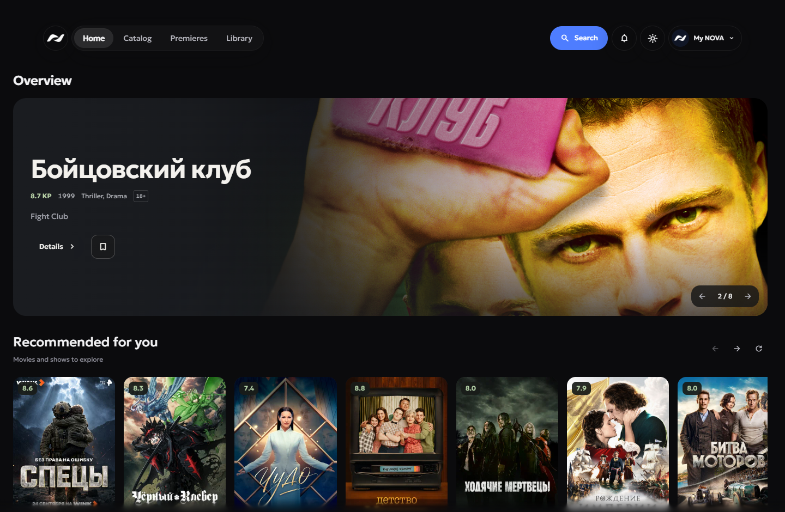
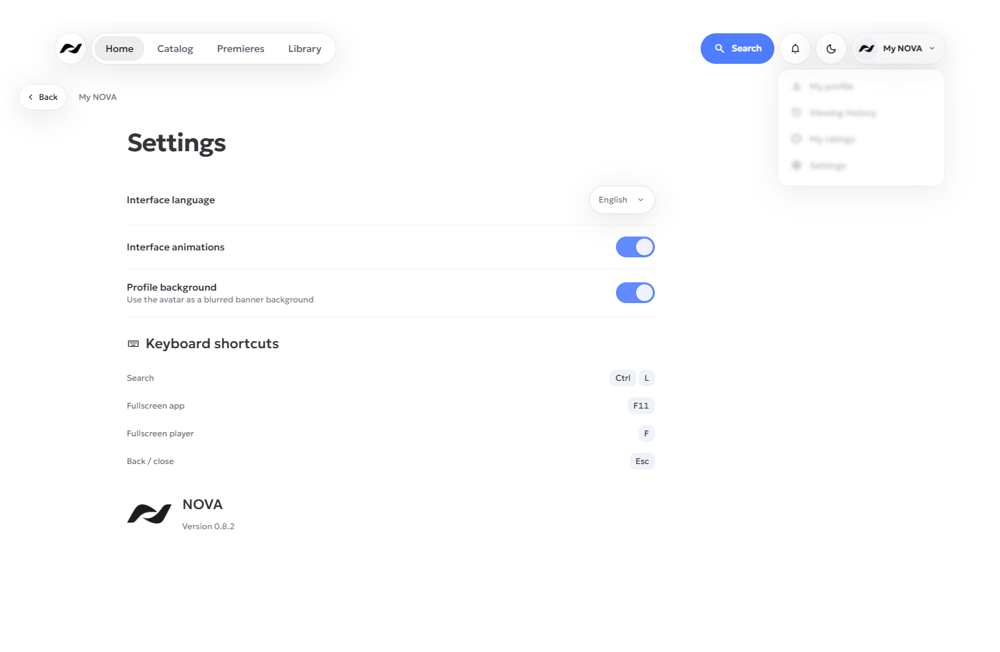

<p align="center"><picture><source media="(prefers-color-scheme: dark)" srcset="src/assets/nova-mark.png"></picture></p>
<h1 align="center">NOVA</h1>
<p align="center">A Windows desktop catalog for movies and TV shows.</p>

<p align="center">
  <a href="https://github.com/DeLorean-bot/NOVA/releases/latest"></a>
  <a href="https://github.com/DeLorean-bot/NOVA/actions/workflows/ci.yml"></a>
  <a href="LICENSE"></a>
</p>

<p align="center"><a href="https://github.com/DeLorean-bot/NOVA/releases/latest">Download for Windows</a> · <a href="README.ru.md">Русский</a> · <a href="docs/architecture.md">Architecture</a></p>



## What you can do

- Browse and search movies and shows, filter by genre or production region, and scroll to load more.
- Open a title page for the synopsis, ratings and trailers. Play available video in an embedded player.
- Save a collection, edit your ratings, and follow releases. Your library and viewing history are stored locally.
- Choose Russian or English in **Settings → Interface language**. Catalog metadata and external players use the languages their sources provide.

## Screenshots

| Search | Settings |
| --- | --- |
|  |  |

Screenshots use a separate profile. Movie artwork and provider marks belong to their respective owners.

## Install

Download the installer or the ZIP from [Releases](https://github.com/DeLorean-bot/NOVA/releases). For the ZIP, extract the entire folder and open `NOVA.exe`. If you previously used Kadr, NOVA reads the same library under `%APPDATA%\Кадр`.

| Shortcut | Action |
| --- | --- |
| Ctrl+L | Open search |
| F | Toggle player fullscreen |
| F11 | Toggle app fullscreen |
| Esc | Close the current panel or exit fullscreen |

## Build from source

Windows x64 and Node.js 24 are used for development and CI.

```powershell
npm ci
npm start
```

Run `npm run check` and `npm test` before submitting a patch. Use `npm run dist` to build the Windows installer and ZIP. To update English wording, edit [the English message catalog](electron/locales/en.json). See [Architecture and startup measurements](docs/architecture.md) for the runtime boundaries and how to reproduce the chart.

## License

NOVA is released under [GPL-3.0-only](LICENSE). You can use, study, modify, and redistribute it under the terms of the license. See [third-party notices](THIRD_PARTY_NOTICES.md) for bundled components and assets.
