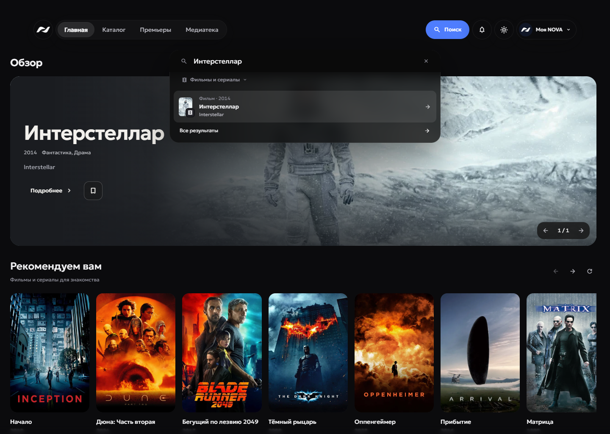
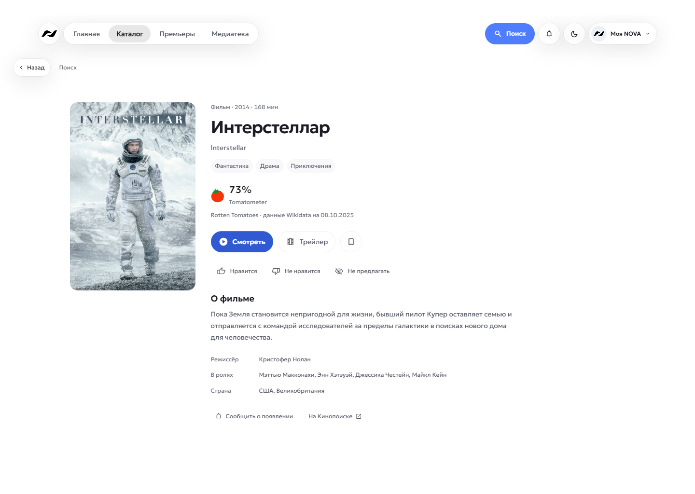
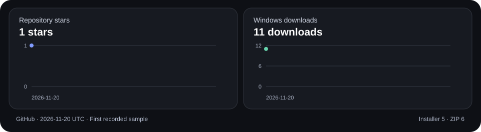

<h1 align="center">
  <picture>
    <source media="(prefers-color-scheme: dark)" srcset="docs/nova-wordmark-dark.png">
    
  </picture>
</h1>

<p align="center">Каталог фильмов и сериалов для Windows с открытым исходным кодом.</p>

<p align="center">
  <a href="https://github.com/DeLorean-bot/NOVA/releases/latest"></a>
</p>

<p align="center">
  <a href="#установка">Установка и ZIP</a> · <a href="#скриншоты">Скриншоты</a> · <a href="#статистика-проекта">Статистика</a> · <a href="#участие-в-проекте">Участие в проекте</a> · <a href="docs/support.md#поддержать-nova">Поддержать NOVA</a> · <a href="README.md">English</a>
</p>

[](docs/screenshots/overview-dark.png)

## Установка

Откройте [последний релиз для Windows x64](https://github.com/DeLorean-bot/NOVA/releases/latest) и выберите файл в разделе **Assets**.

| Файл | Как запустить |
| --- | --- |
| **Установщик** · `NOVA-Setup-*.exe` | Запустите установщик и откройте NOVA из меню «Пуск». Приложение скачивает обновления в фоне и предлагает перезапуск для установки. |
| **ZIP без установки** · `NOVA-*-win-x64.zip` | Распакуйте весь архив и запустите `NOVA.exe`. Переносная версия предложит открыть страницу нового релиза. |

NOVA по умолчанию использует язык Windows. Русский и английский можно выбрать вручную в **Настройки → Язык интерфейса**. Язык обложек и описаний зависит от источника.

[История релизов и контрольные суммы](https://github.com/DeLorean-bot/NOVA/releases) · [Статус сборки Windows](https://github.com/DeLorean-bot/NOVA/actions/workflows/ci.yml)

## Скриншоты

| Поиск в тёмной теме | Карточка фильма в светлой теме |
| --- | --- |
| [](docs/screenshots/search-dark.png) | [](docs/screenshots/details-light.png) |

Скриншоты сделаны в отдельном профиле с демонстрационной подборкой. Права на постеры и кадры принадлежат их владельцам.

- **Найдите фильм** по названию, актёру или детали сюжета. В каталоге можно отфильтровать результаты по году, жанру и стране.
- **Выберите, что посмотреть** с помощью трейлеров, рейтингов, персональных рекомендаций и календаря премьер.
- **Вернитесь к просмотру** через карточку открытого фильма с обложкой. Коллекция, оценки и история хранятся локально.

<details>
<summary>Горячие клавиши</summary>

| Клавиши | Действие |
| --- | --- |
| <kbd>Ctrl</kbd> + <kbd>L</kbd> | Открыть поиск |
| <kbd>F</kbd> | Переключить полный экран плеера |
| <kbd>F11</kbd> | Переключить полный экран приложения |
| <kbd>Esc</kbd> | Закрыть панель или выйти из полного экрана |

</details>

## Статистика проекта

[](docs/activity/README.md)

График строится по ежедневным замерам GitHub. В скачиваниях учитываются установщик и ZIP для Windows. [Данные по дням](docs/activity/history.json) · [Кто поставил звезду](https://github.com/DeLorean-bot/NOVA/stargazers)

## Участие в проекте

NOVA развивается. Сейчас приложение доступно на Windows, в будущем планируется поддержка других устройств. [Сообщить об ошибке](https://github.com/DeLorean-bot/NOVA/issues/new?template=bug.yml) · [Предложить функцию](https://github.com/DeLorean-bot/NOVA/issues/new?template=feature.yml) · [Поддержать разработку](docs/support.md#поддержать-nova)

<details>
<summary>Собрать из исходников на Windows</summary>

Установите Node.js 24 и выполните в корне репозитория.

```powershell
npm ci
npm start
```

Перед открытием pull request выполните `npm run check`, `npm run build` и `npm test`. Установщик и ZIP собираются через `npm run dist`. [Архитектура и замеры запуска](docs/architecture.md) · [Английский перевод](electron/locales/en.json)

</details>

NOVA распространяется под лицензией [GPL-3.0-only](LICENSE). [Лицензии сторонних компонентов](THIRD_PARTY_NOTICES.md)
