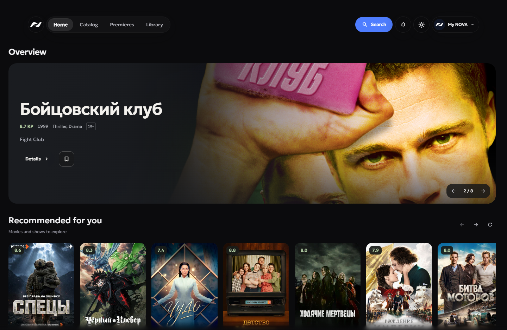

  <a href="https://github.com/DeLorean-bot/NOVA/releases/latest">Скачать</a> · <a href="#скриншоты">Скриншоты</a> · <a href="#статистика">Статистика</a> · <a href="docs/support.md">Поддержать</a> · <a href="README.md">English</a>

NOVA — каталог фильмов и сериалов для Windows. Подборки, поиск с фильтрами, рейтинги, трейлеры и личная медиатека в одном окне. В **Настройки → Язык интерфейса** доступны русский и английский. Язык обложек, описаний и внешних плееров зависит от источника.

## Скриншоты

| Поиск | Настройки |
| --- | --- |
|  |  |

## Статистика

[Звёзды](https://github.com/DeLorean-bot/NOVA/stargazers) · [Релизы](https://github.com/DeLorean-bot/NOVA/releases) · [Данные по дням](docs/activity/history.json) · [Схема и график запуска](docs/architecture.md)

Графики обновляются из GitHub. В скачивания входят установщики и архивы для Windows.

## Установка

[Установщик 0.8.2](https://github.com/DeLorean-bot/NOVA/releases/download/v0.8.2/NOVA-Setup-0.8.2.exe) · [ZIP без установки](https://github.com/DeLorean-bot/NOVA/releases/download/v0.8.2/NOVA-0.8.2-win-x64.zip) · [Все релизы и контрольные суммы](https://github.com/DeLorean-bot/NOVA/releases)

Для запуска из ZIP распакуйте архив целиком и откройте `NOVA.exe`. Поиск открывается по **Ctrl+L**, полный экран плеера — по **F**, полный экран приложения — по **F11**.

## Сборка

На Windows с Node.js 24 выполните `npm ci`, затем `npm start`. Для проверки запустите `npm run check`, `npm run build` и `npm test`. Установщик и ZIP собираются командой `npm run dist`.

## Поддержка и лицензия

[Поддержать через Litecoin](docs/support.md#поддержать-nova) · [Сообщить о проблеме](https://github.com/DeLorean-bot/NOVA/issues/new)

[GPL-3.0-only](LICENSE) разрешает изучать, изменять и распространять приложение на условиях лицензии. [Лицензии сторонних компонентов](THIRD_PARTY_NOTICES.md)
