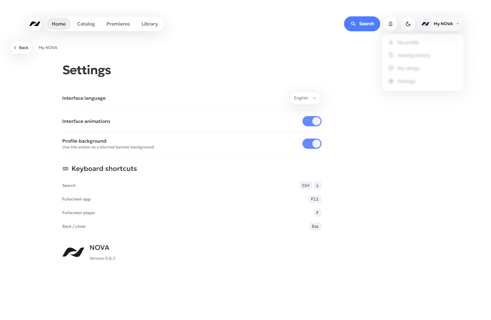

  <a href="https://github.com/DeLorean-bot/NOVA/releases/latest">Скачать</a> · <a href="#скриншоты">Скриншоты</a> · <a href="#статистика">Статистика</a> · <a href="docs/support.md">Поддержать</a> · <a href="README.md">English</a>

> [!NOTE]
> NOVA ещё в разработке. Сейчас приложение доступно на Windows, а в будущем я планирую выпустить его и для других устройств. Буду рад вашим идеям, сообщениям об ошибках и поддержке проекта.
>
> [Предложить функцию](https://github.com/DeLorean-bot/NOVA/issues/new?title=Feature%20request%3A%20) · [Сообщить об ошибке](https://github.com/DeLorean-bot/NOVA/issues/new?title=Bug%3A%20) · [Поддержать донатом](docs/support.md#поддержать-nova)

NOVA — каталог фильмов и сериалов для Windows. Подборки, поиск с фильтрами, рейтинги, трейлеры и личная медиатека в одном окне. По умолчанию язык интерфейса определяется по настройкам Windows. В **Настройки → Язык интерфейса** можно вручную выбрать русский или английский. Язык обложек, описаний и внешних плееров зависит от источника.

## Скриншоты

| Поиск | Настройки |
| --- | --- |
|  |  |

## Статистика

[Звёзды](https://github.com/DeLorean-bot/NOVA/stargazers) · [Релизы](https://github.com/DeLorean-bot/NOVA/releases) · [Данные по дням](docs/activity/history.json) · [Схема и график запуска](docs/architecture.md)

Графики обновляются из GitHub. В скачивания входят установщики и архивы для Windows.

## Установка

[Установщик 0.8.13](https://github.com/DeLorean-bot/NOVA/releases/download/v0.8.13/NOVA-Setup-0.8.13.exe) · [ZIP без установки](https://github.com/DeLorean-bot/NOVA/releases/download/v0.8.13/NOVA-0.8.13-win-x64.zip) · [Все релизы и контрольные суммы](https://github.com/DeLorean-bot/NOVA/releases)

Установленная NOVA загружает изменившиеся блоки в фоне, когда доступна разностная загрузка. О новой версии сообщает уведомление, о готовности к установке — короткий звук. Прогресс и установка с перезапуском доступны из уведомления и в **Настройки → Обновления**. Portable-версия даёт ссылку на скачивание релиза.

Для запуска из ZIP распакуйте архив целиком и откройте `NOVA.exe`. Поиск открывается по **Ctrl+L**, полный экран плеера — по **F**, полный экран приложения — по **F11**.

## Сборка

На Windows с Node.js 24 выполните `npm ci`, затем `npm start`. Для проверки запустите `npm run check`, `npm run build` и `npm test`. Установщик и ZIP собираются командой `npm run dist`.

## Поддержка и лицензия

[Поддержать NOVA](docs/support.md#поддержать-nova) · [Сообщить о проблеме](https://github.com/DeLorean-bot/NOVA/issues/new)

[GPL-3.0-only](LICENSE) разрешает изучать, изменять и распространять приложение на условиях лицензии. [Лицензии сторонних компонентов](THIRD_PARTY_NOTICES.md)
