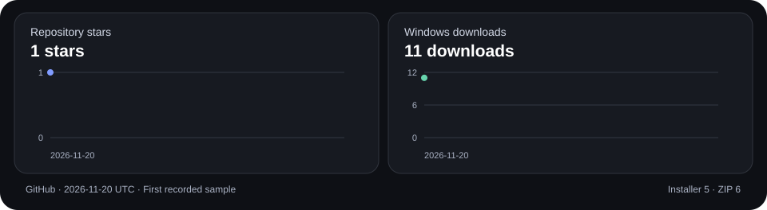

# NOVA activity

[Project](../../README.md) · [Stars](https://github.com/DeLorean-bot/NOVA/stargazers) · [Releases](https://github.com/DeLorean-bot/NOVA/releases) · [Support](../support.md)

The chart uses [daily samples](history.json) collected by [GitHub Actions](https://github.com/DeLorean-bot/NOVA/actions/workflows/repository-metrics.yml) from the repository and release asset APIs. It covers the latest 90 samples. The downloads series adds the installer and portable ZIP counts across published releases. It excludes source archives and checksum files.

В графиках используются реальные значения GitHub. История начинается с первого собранного замера. Загружаемые файлы учитываются отдельно от визитов на страницу.
