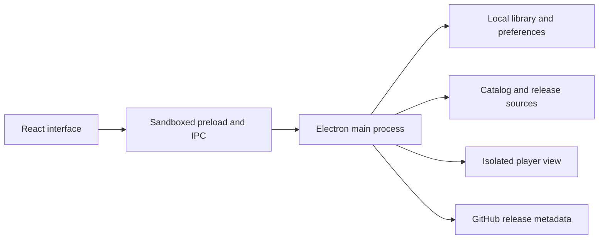
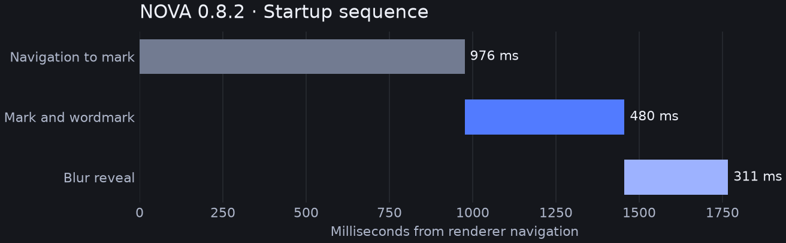

# Architecture

The renderer controls the catalog, details, search and settings. The preload exposes only the commands used by the interface. The main process manages the Windows window, storage, and embedded playback. Premiere availability, catalog lookup, and update checks are asynchronous.

## Startup preview

These timings come from [one isolated Windows x64 run](startup-sample.json) of the packaged app. The clock starts at renderer navigation and measures the splash sequence. Catalog and release checks continue in the background.

To reproduce, build with `npm run build`, then run `node scripts/verify-nova-release.cjs` on Windows with a connection to the catalog. The script stores its images and JSON report under `test-results/`, using an isolated profile. Pass the path to the packaged executable in `KADR_TEST_EXE` to verify a packaged build.

With Matplotlib installed, run `python docs/plot-startup.py path/to/report.json docs/startup.png` to regenerate the chart.
